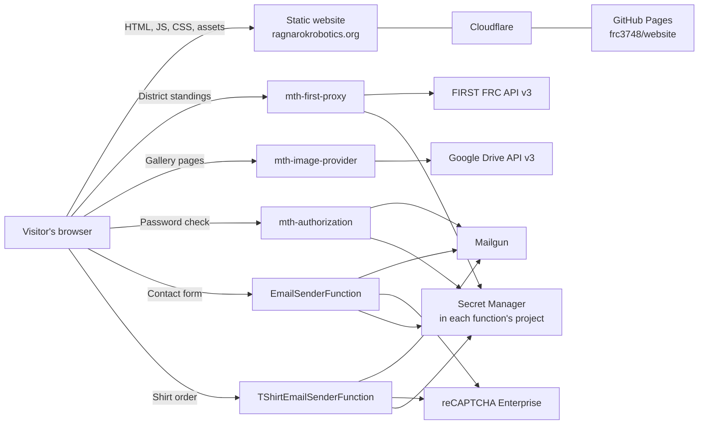

# Ragnarok Robotics Website Technical Guide

Source review dated November 11, 2026. This guide describes the six checkouts in `~/projects/robotics-website`, the browser-to-function contracts, and the Google Cloud settings a maintainer needs to verify before deploying. The repository revisions below identify the source reviewed. Deployed revisions, IAM bindings, service accounts, and scaling settings require a console or CLI check by a maintainer with project access.

## 1. System overview

The [public site](https://ragnarokrobotics.org/) is a static, multipage site for FRC Team 3748. The browser loads HTML, CSS, JavaScript, and assets from the site host. JavaScript calls five independent HTTP functions for operations that need credentials or server-side processing. The functions return JSON or plain text to the browser and use Google Drive, FIRST, reCAPTCHA Enterprise, Secret Manager, or Mailgun as appropriate.



The hosting path in the diagram is supported by the checked-in `CNAME`, the public GitHub Pages endpoint redirecting to the custom domain, and Cloudflare headers on the custom domain. Confirm the selected Pages publishing branch or workflow in GitHub Settings → Pages. The functions are a separate deployment surface. Publishing the website and deploying a function are separate release actions.

| Checkout | Responsibility | Reviewed revision |
| --- | --- | --- |
| [website](https://github.com/frc3748/website) | Static site, browser requests, forms, navigation, galleries, and published results | `194786a`, site `v1.2.4` |
| [mth-authorization](https://github.com/frc3748/mth-authorization) | Shared-password checks and email alerts for a trip page section | `7a1e1f1` |
| [mth-first-proxy](https://github.com/frc3748/mth-first-proxy) | Fetch, normalize, and cache FIRST event and district data | `7c99bea` |
| [mth-image-provider](https://github.com/frc3748/mth-image-provider) | List gallery thumbnail URLs from Google Drive and paginate them for the browser | `7c90985` |
| [mth-inquiry-email-processor](https://github.com/frc3748/mth-inquiry-email-processor) | Validate the contact form and deliver inquiry emails | `9325dcc` |
| [mth-tshirt-order-email-processor](https://github.com/frc3748/mth-tshirt-order-email-processor) | Process a shirt order and email the team and buyer | `825ce70` |

The local function directory names use hyphens. C# namespaces use underscores, and the deployed email functions have different names from their repositories. All six checkouts were on `master` at the reviewed revisions. The local remotes use the `frc3748` GitHub organization. Several older README links still use `mthragnarok`.

## 2. Website development

### Files and technologies

The `website` checkout contains 34 HTML pages and a shared `assets/` directory. There is no package manifest or frontend compilation step. Pages use HTML, CSS, and browser JavaScript, Bootstrap 5.3.2 from jsDelivr, Font Awesome 6.4.0 from cdnjs, and Google Fonts. Pages include Google Analytics and PostHog scripts. These third-party resources require network access in the browser.

| File or group | What to change there |
| --- | --- |
| `template.html` | Starting structure for new pages, including shared assets and layout calls |
| `assets/layout.js` | Shared navigation, footer, current-page highlighting, and `SITE_VERSION` |
| `assets/styles.css` | Dark theme, gold accents, Bootstrap overrides, and reusable classes |
| `assets/gallery.js` | Drive gallery fetch, spinner, lazy-loaded grid, Bootstrap modal, and pagination |
| `index.html`, `about.html`, `team-members.html`, `first-inspires.html` | Home, team, roster, and program content |
| `2024-game.html` through `2027-game.html`, `*-results.html` | Season pages and published event recaps. The ten event result pages currently contain embedded results. |
| `2026-district-rankings.html` | Live FIRST Chesapeake standings and Team 3748 summary |
| `gallery-*.html` | Gallery page layout and per-page Drive folder selection |
| `2026-dcmp-trip.html` | Trip logistics and the lodging-section password UI |
| `contact-us.html`, `order-tshirt.html` | Contact and shirt order forms, including reCAPTCHA configuration |
| `sponsors.html`, `Sponsorship-opportunities.html` | Sponsor content and sponsorship information. Preserve filename case on links. |
| `CNAME`, `sitemap.xml`, `robots.txt`, `404.html` | Custom domain, search discovery, and not-found handling |

The inline `renderNav()` and `renderFooter()` calls replace their own script elements with shared markup. Load `assets/layout.js` before those calls. Navigation determines the active item from the URL filename. When adding a public page, check its navigation links, canonical and social metadata, and sitemap entry. The trip page has a `noindex` tag, which controls indexing rather than access.

### Run locally on macOS or Windows

Use an editor, Git, a current browser with developer tools, and any local static HTTP server. With Python 3 installed:

```sh
cd /path/to/robotics-website/website
python3 -m http.server 8000 --bind 127.0.0.1
```

On Windows, `py -3 -m http.server 8000 --bind 127.0.0.1` works from the checkout root when the Python launcher is installed. Open `http://localhost:8000/`. Using HTTP on localhost lets you test the browser's request and secure-context behavior more realistically than opening a file directly. Production serves the site over HTTPS. The trip page relies on `crypto.subtle` for hashing.

The frontend URLs in the checked-in JavaScript point at production functions. A local page preview can still invoke those services. For development form submissions, use a staging page or edit the endpoint and reCAPTCHA configuration in a disposable checkout to point at a test function and test email recipients. Localhost must be allowed by the applicable reCAPTCHA key when testing a real browser token.

## 3. Cloud function map

All five projects target `net8.0` and implement `IHttpFunction.HandleAsync(HttpContext)` using Google's .NET Functions Framework and ASP.NET Core HTTP types. The hosting package generates the executable entry point. Each checkout contains one handler class, a project file, a solution file, and deployment notes. The inquiry function also has a PowerShell deployment script.

All checked-in browser URLs use `us-east4`. The hostname pattern is `https://us-east4-<project>.cloudfunctions.net/<function>`.

| Function name in URL | Google Cloud project | Entry point | Browser entry |
| --- | --- | --- | --- |
| `mth-authorization` | `mth-web-site-processing` | `mth_authorization.Function` | `2026-dcmp-trip.html` |
| `mth-first-proxy` | `mth-web-site-processing` | `mth_first_proxy.Function` | `2026-district-rankings.html` |
| `mth-image-provider` | `mth-web-site-processing` | `mth_image_provider.Function` | `assets/gallery.js`, called by gallery pages |
| `EmailSenderFunction` | **`mth-email-processor`** | `ragnarok_inquiry_email.Function` | `contact-us.html` |
| `TShirtEmailSenderFunction` | `mth-web-site-processing` | `ragnarok_tshirt_order_email.Function` | `order-tshirt.html` |

Each handler sends `Access-Control-Allow-Origin: *` and answers `OPTIONS` with HTTP 204. The deploy examples allow unauthenticated invocation so browsers can reach the functions. CORS controls which browser origins may read responses. Cloud Run invoker access controls whether the request reaches the handler. Confirm both when troubleshooting a browser request. [Google Cloud function generation and invocation comparison](https://docs.cloud.google.com/run/docs/functions/comparison)

### Public endpoint check on November 11, 2026

An OPTIONS preflight from the site origin returned HTTP 204 with wildcard CORS for authorization, FIRST, galleries, and the contact function. **The shirt order URL returned HTTP 404 without CORS headers.** The order page still points at that URL. Check the deployed function name, project, region, and service URL before relying on the order form. These checks exercised HTTP routing and CORS only. No form or password requests were submitted.

### FIRST competition data

**Source:** `mth-first-proxy/Function.cs`.

- `GET ?districtCode=FCH` returns `ourRanking`, `totalTeams`, and `rankings`. The handler fetches each district rankings page and team-name pages, joins by team number, sorts by rank, and extracts the Team 3748 row. Rows include total points, the first two event codes and points, and district/FIRST championship qualification flags.
- `GET ?eventCode=<code>` returns `ourRanking`, `totalTeams`, `rankings`, `matches`, and `practiceMatches`. The handler requests rankings, results, qualification and practice schedules, and event teams from FIRST. It merges played scores onto the qualification schedule by match number and falls back to played results when no schedule is available. Responses include red/blue alliances, the team's own and opponent scores, and start times. Missing scores use `-1`.
- A district code takes precedence if both parameters are supplied. A missing code yields HTTP 400. Upstream and credential failures return HTTP 502.
- `FrcYear = 2026` and `OurTeamNumber = 3748` are hardcoded. Changing the page URL alone does not select a new season. The current district page polls every five minutes and highlights Team 3748. Current event result pages use embedded HTML even though the proxy has an event route.
- Basic authentication to the FIRST FRC API v3 is derived server-side from Secret Manager's `first-api-token` value, formatted as `username:token`. The project ID is retrieved from the Google metadata server and the auth header is reused within the process.
- Separate event and district dictionaries cache results in memory. The normal TTL is five minutes. `MDPAS`, `MDSEV`, and `FCH` are marked completed and cached for the life of the instance. The constructor schedules prewarming for `MDPAS`, `MDSEV`, `CHCMP`, and `FCH`. A refresh hook exists in the source. Cache changes are per instance, so a five-minute browser poll can still return the same completed-season data.

For a season rollover, coordinate changes to the year, event and district codes, completed-event lists, and any new page using the proxy. Verify the event schedule behavior for playoff results and repeated match numbers before relying on it for a live event. [FIRST FRC API reference](https://frc-api-docs.firstinspires.org/)

### Drive photo galleries

**Source:** `mth-image-provider/Function.cs` and `website/assets/gallery.js`.

1. A gallery page includes the shared loader with `data-folder` set to a Drive folder ID and `data-alt` set to an image-description prefix. The page supplies the grid, spinner, pagination controls, and image modal that the script expects.
2. The script calls `GET ?folder=<drive-folder-id>&page=<number>` on page load and whenever the visitor clicks Previous or Next.
3. The function selects the requested folder, or its configured root folder if the parameter is absent. It uses Application Default Credentials (ADC) for Drive access, requesting the read-only Drive scope where the credential requires explicit scoping.
4. The Drive query selects non-trashed image files directly inside the folder. The code retains filenames that start with a digit and sorts descending by filename. Use the team's sortable numeric filename convention and confirm the generated order.
5. The function rewrites the Drive thumbnail size suffix to request 1200-pixel images and returns up to 40 URLs per response. The contract is `{images, page, totalPages, totalImages}`. Page numbers are clamped. Empty galleries return an empty array in `images`.
6. The browser fetches the actual images from the returned URLs. The function serves the index of URLs. The browser shows an empty state or error message and uses Bootstrap to open images in a modal.

The folder cache lasts 30 minutes per warm function instance. A refresh hook removes the cached entry for the requested folder. Drive failures return HTTP 500 with an empty JSON array. The implementation makes one Drive list request with requested page size 1000 and does not follow a Drive `nextPageToken`. Its 40-item pagination therefore covers only the files in that response. A large or partly returned folder needs upstream pagination support.

For a new gallery, share the intended folder with the runtime identity, add images with the expected naming convention, copy an existing gallery page, update `data-folder` and `data-alt`, and check both thumbnail and modal loading in an unauthenticated browser. Runtime Drive ACLs and browser access to returned thumbnail URLs are separate checks. [Drive files.list reference](https://developers.google.com/workspace/drive/api/reference/rest/v3/files/list)

### Trip-page password check

**Source:** `mth-authorization/Function.cs` and the authentication script at the bottom of `website/2026-dcmp-trip.html`.

The browser trims the password, hashes it with SHA-256, and sends JSON `{serviceKey, passwordHash}` to the authorization function. The page uses the service key `dcmp-trip-2026`. The handler also supports query parameters for legacy calls. Use the POST JSON contract for the site.

The handler normalizes the digest to lowercase and validates that it is a 64-character hex string. It retrieves the latest version of `mth-service-passwords`, a JSON map of service keys to digests, and compares the supplied digest to the stored value using constant-time equality. It returns HTTP 200 with `{authorized: true|false}`, HTTP 400 for malformed input, or HTTP 502 when the lookup fails. The map is cached per process.

On success, the browser records a flag in `sessionStorage` and shows the lodging section for that browser session. The lodging content is already present in the static HTML. Treat this as a visibility control for the page. Confidential content needs a design that serves it only after a server-side authorization decision.

The function schedules a Mailgun notification for a validly formed password check after the lookup, including the result, service key, time, and IP address. The response does not wait for Mailgun. A successful password check and a delivered alert are separate events to verify. The recipient is defined in the handler. Time formatting currently uses a fixed UTC−4 offset.

### Contact form and apparel orders

**Sources:** `mth-inquiry-email-processor/Function.cs`, `mth-tshirt-order-email-processor/Function.cs`, `website/contact-us.html`, and `website/order-tshirt.html`.

Both browser forms generate a reCAPTCHA Enterprise token immediately before submission, add it as `g-recaptcha-response`, and POST browser `FormData` using multipart encoding. The handler reads fields with `ReadFormAsync()`. The inquiry README also describes standard URL-encoded form bodies. Keep the input names, token field, action strings, site key, and backend assessment project coordinated. The browser disables the submit button during the request, presents success or failure, and clears the form on success.

| Contract | Contact | T-shirt order |
| --- | --- | --- |
| Fields | `name`, `email`, `subject`, `message`, `g-recaptcha-response` | `name`, `email`, `tshirtSize`, `g-recaptcha-response` |
| Server-required form values | Nonempty email and message | Nonempty email and shirt size |
| reCAPTCHA expected action | `INQUIRY` | `apparel_order` |
| Score below 0.5 | HTTP 403, skips normal delivery | Sends an admin alert and continues to normal delivery. The rejection branch is commented out. |
| Normal delivery | Team inquiry mailbox and administrator copy with score | Team order mailbox and confirmation to buyer |
| Typical response | HTTP 200 plain text, 400 missing fields, 403 low score, 405 wrong method, 500 exception | HTTP 200 plain text, 400 missing fields, 405 wrong method, 500 exception |

Both use reCAPTCHA's token validity and risk score. An assessment error or invalid token becomes score 0, so the two handlers behave differently in those cases. They supply `ExpectedAction` in the assessment request. Confirm the returned action and hostname in any work that strengthens validation. Mailgun sends via the US API with HTTP Basic authentication and a form-encoded message. Recipient routing and From addresses are defined in source.

The order form is email-based. The code contains no order database, inventory, payment processing, or duplicate-submission protection. Mail sends are sequential, so an error on the second email may occur after the first was accepted. Check Mailgun events before retrying an ambiguous submission. HTTP success means Mailgun accepted the sends, while delivery status is available in Mailgun. [Google reCAPTCHA assessment guidance](https://docs.cloud.google.com/recaptcha/docs/interpret-assessment-website)

## 4. Runtime, configuration, and access

### Required tooling and libraries

| Component | Requirements in the reviewed source |
| --- | --- |
| Static site | Git, editor, modern browser, and optional local static HTTP server. HTML/CSS/JavaScript require no npm build. |
| Function development | A .NET SDK that can target `net8.0`, plus compatible .NET and ASP.NET Core 8 runtimes to execute the current projects locally. A Windows Visual Studio or macOS editor setup can use the same `dotnet` CLI. |
| Function packages | Google.Cloud.Functions.Hosting 3.0.1 in all five projects. Authorization, FIRST, and image provider also explicitly reference Google.Cloud.Functions.Framework 3.0.1. |
| Google API libraries | Google.Cloud.SecretManager.V1 2.7.0 for authorization, FIRST, and both forms. Google.Cloud.RecaptchaEnterprise.V1 2.20.0 for both forms. Image provider uses Google.Apis and Google.Apis.Auth 1.73.0 and Google.Apis.Drive.v3 1.73.0.3996. |
| Mail provider | Verified Mailgun sending domain and credentials for the authorization alert and both forms. Inquiry still references SendGrid 9.29.3 in its project file. Its handler sends with Mailgun. |
| Cloud deployment | Google Cloud CLI, access to the right project, and PowerShell if using the existing `deploy.ps1` directly. Separate repository, cloud, and vendor permissions are needed. |

**Runtime lifecycle.** Google lists November 10, 2026 as the `dotnet8` deprecation date and May 10, 2027 as its decommission date. The reviewed code still targets .NET 8. Deprecation and decommission are separate stages. Schedule a tested .NET 10 migration before decommission, including the project target, NuGet compatibility, function deployment flags, and staging smoke tests. [Google Cloud runtime support schedule](https://docs.cloud.google.com/functions/docs/runtime-support#net)

### Runtime settings and Secret Manager

| Handler | Project discovery | Settings the maintainer must provision |
| --- | --- | --- |
| Authorization | Google metadata server | `mth-service-passwords`, `MAILGUN_API_KEY`, `MAILGUN_DOMAIN` in `mth-web-site-processing` |
| FIRST proxy | Google metadata server | `first-api-token` in `mth-web-site-processing` |
| Image provider | ADC for Drive | Drive API access, runtime account with access to the intended gallery folders, and the configured fallback folder ID |
| Contact | `GCP_PROJECT` | `GCP_PROJECT=mth-email-processor` and that project's `MAILGUN_API_KEY`, `MAILGUN_DOMAIN`, `RECAPTCHA_SITE_KEY` |
| Shirt orders | `GCP_PROJECT` | `GCP_PROJECT=mth-web-site-processing` and that project's `MAILGUN_API_KEY`, `MAILGUN_DOMAIN`, `RECAPTCHA_SITE_KEY` |

Secret reads use version `latest`. The function identity needs `secretmanager.versions.access` on its required secrets, typically through Secret Manager Secret Accessor scoped to those secrets. The forms need permission to create reCAPTCHA assessments in the project that owns the configured key. The image provider needs Drive folder access in addition to having the API enabled. The same secret names in the two projects resolve to different resources. Handle Mailgun key rotation and shared-password updates as operational changes, and check warm-instance behavior because the code holds some values in memory. [Secret Manager access](https://docs.cloud.google.com/secret-manager/docs/access-secret-version)

The inquiry deployment script does not set `GCP_PROJECT` explicitly, even though the constructor reads it. Confirm that the deployed revision supplies it before reusing the script. The shirt README deployment command sets it explicitly. The shirt repository's tracked `.env.yaml` contains a `MAILGUN_DOMAIN` setting. The shown deployment command does not consume that file, and the current handler gets the domain from Secret Manager.

### Identities and API access

- **Developer identity.** GitHub access to all six repos and Google Cloud access to inspect the functions and logs in both projects. Use the team-approved deployment identity when publishing.
- **Build and deployment identities.** Source deployments use the Cloud Functions v2 API, Cloud Build, buildpacks, Artifact Registry, and Cloud Run. Review the project APIs and the permissions of the deployer and the build service account. Use the existing runtime account and service configuration when replacing a revision.
- **Function identity.** Cloud Run provides ADC for its attached service account. Give each identity only the Secret Manager, assessment, or Drive access needed by its handler. Local ADC is separate from the CLI's selected login and project. [Google ADC documentation](https://docs.cloud.google.com/docs/authentication/application-default-credentials)
- **Site and vendor access.** Confirm team access to GitHub Pages, Cloudflare DNS/cache settings, FIRST API credentials, Drive photo folders, the two reCAPTCHA configurations, and Mailgun sending domains and event logs.

A production inventory should record function URLs, deployed revisions, region, runtime, service-account identities, memory, timeout, concurrency, instance limits, and ingress/invoker settings. These values are established by cloud configuration rather than by the C# files. The code uses in-memory caches, so parallel instances can serve different cache ages. FIRST prewarming and authorization alerts are background tasks. Their completion is sensitive to instance lifetime and CPU allocation. [Cloud Run function deployment](https://docs.cloud.google.com/run/docs/deploy-functions)

## 5. Local backend development and testing

1. Clone the appropriate function beside `website`. Work in the function directory containing its `.csproj`. From that directory, run `dotnet restore` and `dotnet build`. Use `dotnet --list-sdks` and `dotnet --list-runtimes` to check the development machine.
2. For a local HTTP process, run `dotnet run`. The Functions Framework normally selects the single handler and listens on port 8080. To choose a target and port explicitly, use `dotnet run -- --target mth_image_provider.Function --port 8081`, replacing the target as needed. [Functions Framework for .NET](https://github.com/GoogleCloudPlatform/functions-framework-dotnet)
3. Use authorized ADC for calls to Google APIs, such as `gcloud auth application-default login` where the team allows user ADC. The forms need `GCP_PROJECT` set for the test project, using `export GCP_PROJECT="<test-project-id>"` in a POSIX shell or `$env:GCP_PROJECT = "<test-project-id>"` in PowerShell. The constructor reads secrets before serving the form.
4. Authorization and FIRST resolve their project via the Google metadata hostname, which is normally present only in Google Cloud. Local ADC by itself does not supply that lookup. Use a staging function for an end-to-end test, or introduce an explicit local project setting and a testable dependency boundary as part of a reviewed change.
5. Test the image provider against a non-production gallery shared with the test identity. Verify the Drive OAuth scope, ACL, image naming, and pagination with a representative folder.
6. For email, use a test reCAPTCHA key and a test Mailgun domain or controlled recipients. The current handlers have hardcoded routing and no dry-run switch. A request to a deployed endpoint can send real messages, including authorization attempt alerts.

On the reviewed Mac, the installed CLI reported .NET SDK 10.0.402 and .NET/ASP.NET Core 10.0.13, with no .NET 8 runtime in that CLI's runtime list. That environment needs a compatible runtime to run the existing target locally, or a validated target migration. `gcloud` was absent from the shell PATH used for this review.

### Acceptance checks for a change

| Change | Check |
| --- | --- |
| Static content or nav | Load pages from localhost. Verify desktop/mobile navigation, active link, footer version, local assets, console, and responsive layout. |
| Gallery | Check page one, last page, empty folder, missing/invalid folder, Previous/Next controls, and modal. Check browser access to returned image URLs. |
| FIRST proxy | Check district and event JSON with known data in staging. Confirm team row, ordering, empty/missing cases, response errors, and freshness. Check both frontend and backend when changing JSON fields. |
| Authorization | Use a staging service key. Check malformed input, denied password, valid password, page reload in the same session, and alert logs. Verify separately whether the content requires server-side protection. |
| Contact and apparel | Verify missing field rejection, token validity and action, low-score behavior, successful email routing, and the user's UI response. Check Mailgun acceptance and delivery separately. |
| Cloud release | Confirm deployed project, function name, runtime, entry point and service URL, then verify a representative staging request and review Cloud Logging. |

The source review found no tracked test projects, CI workflows, infrastructure definitions, or centralized deployment pipeline across these six repos. The static link check found zero missing local `href`/asset `src` references in the 34 HTML pages. That check covers local paths in HTML. Browser behavior, external links, Google API access, and mail delivery require the smoke checks above.

## 6. Deploying and operating the system

### Publish the website

1. Use the website's `CLAUDE.md` for its branch and version conventions. It describes a versioned development branch, version changes only when requested or when setting up that branch, and an explicit merge into `master`.
2. For a release version update, edit `SITE_VERSION` in `assets/layout.js`, the version note in `README.md`, and all shared `styles.css`, `layout.js`, and `gallery.js` query-string versions in the HTML. At the reviewed commit, the site version is `v1.2.4` and all 76 matching shared asset references use `?v=1.2.4`.
3. Confirm GitHub Settings → Pages publishing source and custom domain, then use the team's release procedure. Keep `CNAME` at the publishing root. The repo notes describe purging the Cloudflare cache after release and a four-hour CSS/JS cache window. Check the current Cloudflare rule before assuming that duration.
4. Confirm the footer and asset URLs on the public site after publishing. If a page shows stale navigation or styling, compare the returned HTML asset versions and Cloudflare cache behavior before rebuilding a function.

Public checks for this guide found that `frc3748.github.io/website/` returns a GitHub redirect to the configured domain. A HEAD request to the custom domain returned a Cloudflare 403 in the inspection environment, so the production cache headers and current published revision could not be verified. An older `mth-web-site-processing.uc.r.appspot.com` website URL returned 404 and the older `www.mthragnarok.com` hostname did not resolve in the check. The checked-in canonical domain is `ragnarokrobotics.org`. [GitHub Pages custom-domain documentation](https://docs.github.com/en/pages/configuring-a-custom-domain-for-your-github-pages-site/about-custom-domains-and-github-pages)

### Deploy a function from source

The repository commands use `gcloud functions deploy` with an HTTP trigger and `dotnet8`. Authorization and both form examples explicitly specify `--gen2`. The FIRST and gallery README examples omit it, but Google's support table lists `dotnet8` for Cloud Run functions. Inspect the existing deployments before changing generation or runtime flags.

Use each function checkout as its source root. The `.gcloudignore` files exclude Git metadata and include each repo's `.gitignore` patterns. Inspect the upload list with `gcloud meta list-files-for-upload` so the build gets the project file and handler source. The source deploy runs a Google-managed build, stores the image in Artifact Registry, and updates the Cloud Run function. The runtime project, entry point, and browser URL must agree. [Functions Framework deployment notes](https://github.com/GoogleCloudPlatform/functions-framework-dotnet/blob/main/docs/deployment.md)

For an existing service, a maintainer can inspect its current deployment with a read-only command like this:

```sh
gcloud functions describe mth-image-provider \
  --gen2 --project=mth-web-site-processing --region=us-east4 \
  --format='yaml(name,state,buildConfig.runtime,buildConfig.entryPoint,serviceConfig.uri,serviceConfig.serviceAccountEmail,serviceConfig.availableMemory,serviceConfig.timeoutSeconds,serviceConfig.maxInstanceRequestConcurrency,serviceConfig.ingressSettings)'
```

Use the function table to substitute the correct name and project. Inspect IAM and secret access separately. Before deploying, record the source revision and existing cloud settings, confirm the runtime is supported for the intended release, and use an explicit project and region. For the inquiry function, read `deploy.ps1` before use because it changes the active `gcloud` project. For both forms, verify the environment, key ownership and allowed hostnames, and email routing before switching a frontend URL.

After a staging deploy, confirm response shape and CORS using the browser. Production rollback should restore a known-good website commit or function revision using the team's publishing process. Keep the previously deployed source SHA and configuration available to make that possible.

### Troubleshooting

| Symptom | Start here |
| --- | --- |
| Nav or footer missing | Check `assets/layout.js` loads before the inline render calls. Inspect the browser console and asset URLs. |
| New page or styles look stale | Check the published GitHub revision, `?v=` references, browser cache, and Cloudflare cache rules. |
| Browser reports CORS or a function 403 | Inspect the Network tab for status and response headers. Verify function URL/project, invoker/ingress settings, and preflight response. An inquiry handler HTTP 403 also means the reCAPTCHA threshold was not met. |
| FIRST returns 502 | Check project metadata/ADC, `first-api-token` access and format, FIRST upstream status, event or district code, and the hardcoded season. |
| District ranks refresh without changing | Check the per-instance completed-event cache. `FCH` is marked static. |
| Gallery is empty | Check folder ID, runtime Drive permission, image MIME type, and filenames beginning with digits. Inspect the returned JSON and warm cache age. |
| Gallery JSON works but thumbnails fail | Check that browser visitors can load the returned URLs. Review Drive sharing and URL freshness. |
| Form function fails on startup | Confirm `GCP_PROJECT`, secret names/versions, and runtime identity permissions. |
| Form returns 500 or a message is missing | Compare Cloud Logging to reCAPTCHA assessment results and Mailgun request/delivery events. Check both recipient sends before retrying. |
| Trip password works but no alert arrives | Check authorization logs and Mailgun separately. The alert is scheduled in the background. |

Use Cloud Logging with the function's actual project and service name. Retain the request timestamp and status when escalating. Form logs can contain submitted email addresses and serialized reCAPTCHA assessments, so limit access and redact those details when sharing diagnostic output.

## 7. Handoff items for the next maintainer

1. **Verify the shirt-order endpoint.** Its configured browser URL returned HTTP 404 during the public preflight check. Confirm the Cloud Run function and URL in the console before testing order delivery.
2. **Confirm the deployed configuration.** Record the Pages publishing source, Cloudflare rule, deployed source revisions, IAM and runtime identities, and the two projects' enabled APIs and environment settings. Those are the parts of the system that cannot be reconstructed from the checkouts alone.
3. **Plan the .NET runtime migration.** The five projects share a deprecated runtime target. Test one function on .NET 10 in staging, then qualify the other handlers and confirm the NuGet and deployment changes together.
4. **Settle form and trip privacy requirements.** Confirm whether apparel orders below the reCAPTCHA threshold should still send email. The source currently does. Review action/hostname checks, HTML encoding of submitted text, and what gets logged or returned to the browser. If trip information requires confidentiality, move it out of static HTML into a protected response.
5. **Document gallery access and cache ownership.** Maintain a list of public gallery folders and share the minimum needed with the Drive runtime identity. The handler accepts a folder parameter and its reach is bounded by that identity's access. Move cache invalidation credentials out of source and manage rotation with the team. Avoid publishing refresh token values in docs or URLs shared outside the team.
6. **Add a repeatable staging check for each endpoint.** Keep example requests and expected response shapes, a test gallery, and controlled mail recipients. Include tests for missing fields, errors, low reCAPTCHA scores, and request concurrency. FIRST and Drive use mutable static dictionaries that need review if the deployed service handles concurrent requests per instance.

### Source and reference map

The handlers and browser scripts listed above are the primary references for behavior. Use `website/README.md` for the page catalog, `website/CLAUDE.md` for release conventions, each function's `.csproj` for dependency versions, each function's `README.md` for its deployment example, and `mth-inquiry-email-processor/deploy.ps1` for the checked-in contact deployment command. Read the handler when README descriptions conflict with behavior.

- [Google Cloud CLI installation](https://docs.cloud.google.com/sdk/docs/install)
- [Google Cloud Functions Framework for .NET](https://github.com/GoogleCloudPlatform/functions-framework-dotnet)
- [Google Cloud runtime lifecycle](https://docs.cloud.google.com/functions/docs/runtime-support)
- [Google Cloud Application Default Credentials](https://docs.cloud.google.com/docs/authentication/application-default-credentials)
- [Google Cloud Secret Manager access](https://docs.cloud.google.com/secret-manager/docs/access-secret-version)
- [Google Drive API files.list](https://developers.google.com/workspace/drive/api/reference/rest/v3/files/list)
- [Google reCAPTCHA website assessments](https://docs.cloud.google.com/recaptcha/docs/interpret-assessment-website)
- [FIRST FRC API documentation](https://frc-api-docs.firstinspires.org/)
- [GitHub Pages custom domains](https://docs.github.com/en/pages/configuring-a-custom-domain-for-your-github-pages-site/about-custom-domains-and-github-pages)
